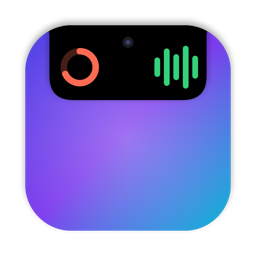

<p align="center">
  
</p>

<h1 align="center">EasyNotch</h1>

<p align="center">
  Your MacBook's notch, put to work: music controls, a file shelf with AirDrop, a Pomodoro
  timer, your next meeting, battery, and system stats. Hover to open.
</p>

---

## What it does

EasyNotch draws over your notch at exactly its size, so when it's closed you can't tell it's
there. Hover over it, or click if you prefer, and it opens into a panel.

- **🎵 Music**
  - Spotify and Apple Music: cover art, title, a timeline you can drag, play/pause,
    previous/next, shuffle, repeat, and volume.
  - Switch between players when both are open.
- **📁 File shelf**
  - Drag files onto the notch, then drag them back out into an upload field, Slack, Mail,
    or Finder whenever you need them.
  - AirDrop them with one drop, Quick Look them, share them, or copy them.
  - The shelf follows files you rename or move.
- **🍅 Pomodoro timer**
  - Focus sessions, short breaks, and a long break every few sessions, with notifications
    and a sound you choose.
  - Keeps accurate time through sleep and restarts.
- **📅 Next meeting**
  - Your next event and an agenda of the coming days (you choose how far ahead), with a
    **Join** button for Zoom, Google Meet, Teams, Webex, and FaceTime links.
  - Works with iCloud, Google, Outlook/Exchange, and any other calendar account added in
    System Settings → Internet Accounts. EasyNotch never signs in to them itself.
  - A countdown beside the notch a few minutes before each one starts.
- **🔋 Battery & charging**
  - Charge, time left, charger wattage, battery health, and cycle count.
  - Shows why a plugged-in Mac is "holding at 80%".
  - A charging flash when you plug in, and a warning when the battery runs low.
- **📊 System monitor**
  - CPU, memory, and network speed with live charts, plus free disk space.
  - Optionally shows big downloads beside the notch.
  - It only measures while you're looking at it.
- **>_ Claude Code**
  - Answer Claude Code's permission requests (Allow or Deny) from the notch instead of
    switching to the terminal. Requests from several sessions queue up.
  - Shows your 5-hour and weekly usage (Pro, Max, and Ultra plans), when Claude Code reports it.
  - Optional: turn it on in Settings → Claude Code. See below for exactly what that changes.
- **✨ Live activities.** The closed notch grows small "wings" when something is happening:
  - cover art with bouncing bars while music plays
  - the time left on a timer
  - a meeting about to start
  - a Claude Code request waiting
  - the charging flash
  - the low-battery warning
- **⚙️ Customization**
  - **Size and timing:** size, hover and close delays, open by hover or click, and
    animation style.
  - **Look:** accent color.
  - **Tabs:** which tabs show, in what order, and which opens first.
  - **Screens:** show the notch on other screens (they get a virtual one), and hide it over
    full-screen apps.
  - **General:** a keyboard shortcut, launch at login, and export/import of your settings.
- **🪶 Light:** about 0% CPU while idle, and about 30 MB of memory.

## Requirements

- macOS 14 Sonoma or later.
- Made for MacBooks with a notch. Other screens get a virtual notch.
- For the music features, Spotify and/or Apple's Music app.

## Install

1. Download **EasyNotch-1.2.0.zip** from the
   [latest release](https://github.com/Sean13L/EasyNotch/releases/latest).
2. Unzip it and drag **EasyNotch** into your **Applications** folder.
3. Open it. macOS will say *"Apple could not verify 'EasyNotch' is free of malware…"*. Click
   **Done**.
   > This happens because EasyNotch isn't *notarized* (Apple's check for downloaded apps
   > needs a paid developer account). The app is signed, and its full source code is right
   > here.
4. Open **System Settings → Privacy & Security**, scroll down, click **Open Anyway** next to
   EasyNotch, and confirm.
5. Look for EasyNotch's icon in the menu bar, then hover over your notch.

**Tips**
- Right-click the notch, or use the menu-bar icon, to open **Settings**.
- To start EasyNotch automatically, go to Settings → General → *Open EasyNotch when you log
  in*.

## Permissions and privacy

EasyNotch asks only for what a feature needs, and only when you first use it:

| macOS asks… | Why | When |
|---|---|---|
| *"EasyNotch wants to control Spotify / Music"* | To play, pause, skip, and show cover art | When you press a music button or **Allow…** |
| Notifications | To tell you when a Pomodoro session ends | When you first start a timer |
| Calendars | To show your next meeting and its Join link. Events stay on your Mac | When you press **Allow Calendar Access** in the Calendar tab |
| Access to Downloads, Desktop, or Documents | To reopen shelf files stored there | The first time a shelf file from that folder is shown |

EasyNotch doesn't need Accessibility or Screen Recording access.

It has no analytics and no accounts. The only thing it downloads is Spotify's cover art for
the song you're playing. Battery and system stats need no permission at all.

## Claude Code

This is off until you press **Connect** in Settings → Claude Code. EasyNotch is an unofficial
companion and isn't affiliated with Anthropic.

**What Connect changes in `~/.claude/settings.json`:**
- It adds a `PermissionRequest` hook that runs EasyNotch's small helper
  (`EasyNotch.app/Contents/Helpers/easynotch-claude permission`). The notch then shows the
  request, and your Allow or Deny goes back to Claude Code.
- It sets the status line to the same helper (`… statusline`) to read your usage figures. If
  you already had a status line, it still runs and still shows: EasyNotch wraps it and keeps
  a copy of the original in `settings.json.easynotch-statusline`.
- Your other settings and hooks are left alone, but the file is rewritten, so key order and
  spacing may change.
- Before the first change it copies your file to `settings.json.easynotch-backup`.

**What stays on your Mac:** the helper talks to EasyNotch through a private file
(`~/Library/Application Support/EasyNotch/claude.sock`) that only your user can open. It opens no
network port and sends nothing anywhere. It passes the tool name, a short summary of what it
wants to do, and the project folder name to the notch. From the status line it also passes your
5-hour and weekly usage percentages and reset times. All of it stays on your Mac, and EasyNotch
stores none of it.

**Good to know:**
- If EasyNotch isn't running, is quitting, or you hide the Claude tab, Claude Code asks in
  the terminal as usual. Pressing Ctrl-C in Claude removes the request from the notch.
- Your own deny rules in Claude Code still win over **Allow**, per Claude Code's hook docs.
- A request can only be answered from the notch half a second after it becomes the front one.
- If you move EasyNotch to another folder, press **Reconnect**. Until then, Claude Code asks
  in the terminal.

**To undo it:** press **Disconnect** in Settings → Claude Code. It removes only EasyNotch's
hook and status line and puts your original status line back (if you didn't have one, EasyNotch's is simply removed). You can also delete those
entries by hand, or restore `settings.json.easynotch-backup` over `settings.json`. Any command
containing `easynotch-claude` is EasyNotch's.

## Build from source

1. Install [Xcode](https://apps.apple.com/app/xcode/id497799835) (16 or later) and
   [XcodeGen](https://github.com/yonaskolb/XcodeGen):
   ```bash
   brew install xcodegen
   ```
2. In `project.yml`, change `DEVELOPMENT_TEAM` to your own team ID (Xcode → Settings →
   Accounts), or to `""` together with `CODE_SIGN_IDENTITY: "-"` to sign for your Mac only.
3. Generate the Xcode project and build:
   ```bash
   xcodegen generate
   xcodebuild -project EasyNotch.xcodeproj -scheme EasyNotch -configuration Release -derivedDataPath build build
   open build/Build/Products/Release/EasyNotch.app
   ```

Documentation for contributors:
- [docs/BLUEPRINT.md](docs/BLUEPRINT.md): architecture and design decisions
- [docs/DEVELOPMENT.md](docs/DEVELOPMENT.md): debugging tips and lessons learned
- [docs/QA_CHECKLIST.md](docs/QA_CHECKLIST.md): the hands-on test script

## License

[MIT](LICENSE) © 2026 Sean Le
